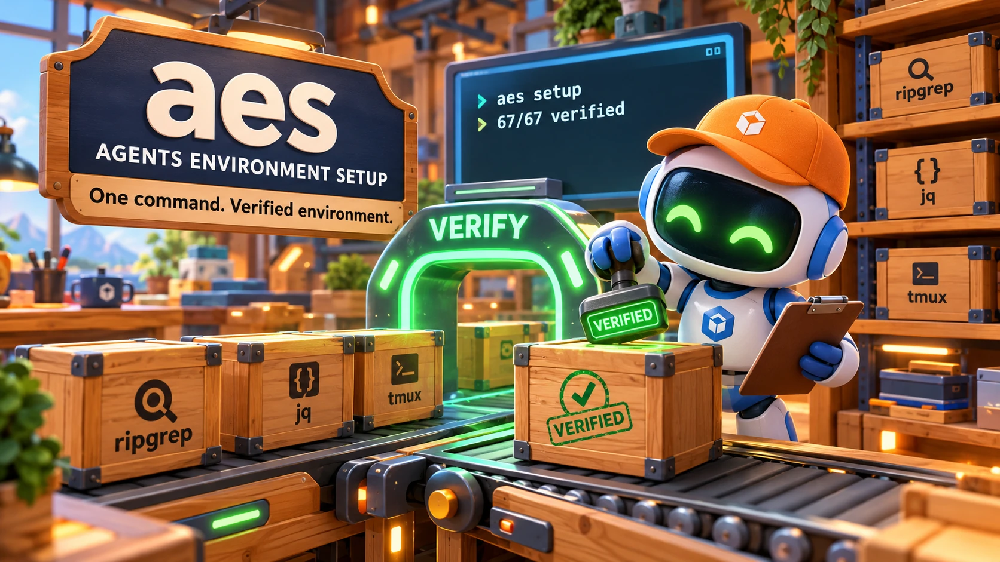

# aes — Agents Environment Setup

<div align="center">
  
</div>

<div align="center">


</div>

**One command takes a machine from nothing to a complete AI coding environment — and exits 0 only when it actually is.**

`aes setup` resolves a typed catalog into a dependency-ordered list of actions, verifies what is already on the box, installs only what is missing, verifies again, and refuses to call the run done until every action's binary is real and runnable. **v0.1.1: 68 tools in the catalog, 67 verified end to end.**

<div align="center">

```bash
curl -fsSL "https://raw.githubusercontent.com/quangdang46/agents_environment_setup/main/install.sh?$(date +%s)" | sh
export PATH="$HOME/.aes/bin:$PATH"   # install.sh prints this line
aes setup
```

</div>

---

## For agents

`aes` is built to be driven by another program. The stdout/stderr split and the
exit codes are a contract, not an implementation detail.

**Never run bare `aes` in an agent context** — it opens an interactive TUI.
Without a terminal it degrades to printing help instead of hanging, but you
still get nothing machine-readable.

```bash
# 1. What would this do? Resolves and prints; changes nothing.
aes setup --dry-run --json

# 2. What is actually on this machine? Status comes from verification, not state.
aes list --json

# 3. Check only. Exits 6 if any selected tool is missing, stale, or unknown.
aes verify --json

# 4. Where does the record disagree with reality? Exits 6 when it finds an error.
aes doctor --json

# 5. Install for real. Never prompts; escalates via `sudo -n` only.
aes setup --non-interactive --json

# 6. Make the installed bins reachable in the next shell.
aes env --write
```

**Output contract**

| Stream | Carries |
|---|---|
| `stdout` | Exactly **one** JSON document under `--json`. Never prose. |
| `stderr` | Human-readable diagnostics, progress, warnings, printed commands |
| exit `0` | Every resolved action verified |
| exit `2` | Invalid usage or a bad flag |
| exit `3` | Catalog or manifest invalid, or a corrupt state file |
| exit `4` | Unsupported platform |
| exit `5` | **A privileged step needs a human** — run the printed command, then re-run |
| exit `6` | Verification failed after install, or `doctor` found drift |

Code `5` exists so you can tell *"you must do something"* from *"it broke"*.
Neither blocking on a prompt nor reporting a failure is a correct response to
`5`. Code `6` from `doctor` or `verify` is **data**, not a crash: read the JSON,
then decide. In an agent loop, `aes doctor --json || true` is usually correct.

`AGENTS.md` is written for agents: package layering, the fifteen invariants,
and the traps that have cost real time here. Read it before changing the core.

---

## The problem

Setting up a new machine for AI-assisted coding is a scatter of one-off steps:
install ripgrep, git, jq, a terminal multiplexer, a fuzzy finder, two or three
coding agents, wire up `PATH` so the binaries are actually reachable — then
discover a week later that an agent's binary landed in `~/.local/bin` and
nothing can find it.

The setup scripts that try to automate this are shell soup. They do not know
what they installed, they re-run everything after an interruption, and they
`sudo` without asking. A package manager knows about packages, not about the
environment those packages are supposed to form.

## The solution

AES treats installation as a **declared, verifiable** process:

- **Tools are declarations.** A `tool.yaml` says how to install per platform,
  which binary proves presence, and which version is too old. The strategy set
  is closed, so a manifest cannot smuggle in a command.
- **Installation is resolved, not scripted.** Dependencies become a DAG, the
  plan is topologically sorted and deduplicated, and identical input produces
  byte-identical output.
- **Success is measured, not assumed.** A tool counts as installed only after a
  post-install verification passes. State is a cache; the binary is the truth.
- **Privilege is never silent.** When root is genuinely required, AES prints
  the exact command and asks — or uses `sudo -n` in automation and reports exit
  `5` when that is unavailable.

## Why aes?

| What you get | How it works here |
|---|---|
| **Verify-first resume** | Tool 27 does not redo tools 1–26. Present tools are verified, not reinstalled. |
| **Post-install proof** | Every install is followed by a version probe. State is written only after it passes. |
| **Drift detection** | `aes doctor` compares the record against the binaries and names the repair command. |
| **No executable config** | Six install strategies, unknown fields rejected at parse time. There is no `run:` field. |
| **Deterministic actions** | Sorted, deduplicated, byte-identical for the same input. |
| **Derived privilege** | Only `package` + `apt` escalates. A `sudo` in a command is refused before execution. |
| **Managed `PATH`** | `aes env --write` emits one deterministic `env.sh` covering every install strategy. |
| **Platform honesty** | `tested_on` is per platform. A tool not proven on this host is skipped, not assumed. |
| **Agent surface** | One JSON document on stdout, diagnostics on stderr, stable exit codes. |

## How it compares

| | Shell script | mise / asdf | Nix | **aes** |
|---|---|---|---|---|
| Resumes after interruption | rewrite or rerun all | yes | yes | **yes — verifies before installing** |
| Knows what it installed | no | shims + versions | store | **yes, and checks binaries against it** |
| Detects drift | no | partial | store integrity | **`aes doctor`** |
| Config can execute arbitrary code | yes | plugins may | Nix language | **no — closed schema** |
| Pins exact versions and checksums | manual | mostly versions | yes | **yes, per platform and asset** |
| Handles privilege | silently, if at all | rarely needed | explicit | **prints the command, then asks** |
| Manages `PATH` | manual | shims | profiles | **`aes env --write`** |
| Cross-ecosystem breadth | whatever you script | many plugins | packaging effort | **release, apt/brew, npm, go, cargo, uv** |
| Machine-readable status | no | no | no | **`--json` + exit codes** |

AES is not a replacement for mise, asdf, or Nix. It is the layer that says
*"this machine is ready"* and can prove it — and it will use a package manager
or a pinned release to get there.

---

## Quick example

```bash
# Resolve the default set for this host. Nothing changes.
aes setup --dry-run

# Install one tool and its dependencies. An explicit --only replaces the default set.
aes setup --only ripgrep

# Selecting and excluding the same tool is a usage error (exit 2), not a silent choice.
aes setup --only jq --exclude jq

# Unattended install for CI. Never prompts; a required manual step ends in exit 5.
aes setup --non-interactive --json

# Status from verification, not from ~/.aes/state.json.
aes list

# Verify only; exit 6 if anything selected is missing or stale.
aes verify ripgrep; echo "exit=$?"

# State says installed, binary is gone? Doctor names the drift and the repair.
aes doctor --json; echo "exit=$?"      # 6 means findings, not a crash

# Write the environment file; optionally link it into your shell rc.
aes env --write
aes env --write --link-shell

# Remove a tool through its own strategy, or just stop tracking it.
aes uninstall jq --confirm
aes forget jq --confirm
```

---

## Design principles

| Principle | What it means here |
|---|---|
| A manifest is data, never a program | No `run:` field. A typo fails validation instead of executing. |
| Privilege is a property of the strategy | No `needs_sudo` field. Only `package` + `apt` escalates. |
| Verify is ground truth; state is a cache | Never decide from `state.json` alone. |
| Corruption is an error, never emptiness | A truncated file must not read as "nothing installed". |
| Refuse loudly rather than fail quietly | An unknown strategy errors and lists the valid set. |
| Two frontends, one engine | The TUI and the CLI call the same `selection.Resolve`, so identical `Action`s hold by construction, not by agreement. |
| Skip is honest, force is explicit | An unproven platform is skipped; `--allow-unproven` is the visible opt-in. |

---

## Installation

`install.sh` installs **aes only**. It does not install tools — that is
`aes setup`'s job, and keeping the bootstrap to five steps is deliberate.

### 1. Bootstrap (recommended)

```bash
curl -fsSL "https://raw.githubusercontent.com/quangdang46/agents_environment_setup/main/install.sh?$(date +%s)" | sh
```

Pin a release, or change the prefix:

```bash
curl -fsSL "https://raw.githubusercontent.com/quangdang46/agents_environment_setup/main/install.sh?$(date +%s)" \
  | sh -s -- --version v0.1.1 --prefix "$HOME/.aes"
```

The bootstrap detects OS/arch, downloads the release asset, verifies its
sha256 against `checksums.txt`, refuses archive entries with absolute or `..`
paths, and then runs `aes --version`. A checksum mismatch aborts before the
binary is written.

Flags it actually accepts: `--version`, `--prefix`, `--base-url`, `--help`.
There is no `--easy-mode`; this installer rejects unknown flags rather than
guessing.

### 2. Download a release directly

```bash
V=v0.1.1
OS=darwin          # darwin | linux
ARCH=arm64         # arm64 | amd64
BASE="https://github.com/quangdang46/agents_environment_setup/releases/download/$V"

ASSET="aes-${V#v}-$OS-$ARCH.tar.gz"
curl -fsSLO "$BASE/$ASSET"
curl -fsSLO "$BASE/checksums.txt"

EXPECTED=$(awk -v f="$ASSET" '$2 == f || $2 == "*"f { print $1; exit }' checksums.txt)
ACTUAL=$(shasum -a 256 "$ASSET" | awk '{ print $1 }')     # sha256sum on Linux
[ "$ACTUAL" = "$EXPECTED" ] || { echo "checksum mismatch"; exit 1; }

tar -xzf "$ASSET"
mkdir -p "$HOME/.aes/bin"
install -m 0755 aes "$HOME/.aes/bin/aes"
```

### 3. Build from source

```bash
git clone https://github.com/quangdang46/agents_environment_setup
cd agents_environment_setup
make check          # gofmt + vet + race
make build          # dist/aes
make install        # $AES_PREFIX/bin/aes, default ~/.aes/bin/aes
```

The catalog is embedded in the binary, so an installed `aes` needs no files
beside itself.

---

## Commands

| Command | What it does |
|---|---|
| `aes setup` | The North Star: install and verify a complete environment |
| `aes list [tool...]` | Catalog tools with status from verification, not from state |
| `aes verify [tool...]` | Check without modifying; exits 6 if anything is not OK |
| `aes doctor` | Report drift and environment health; reports, never fixes |
| `aes env` | Print `env.sh`, `--write` it, or `--link-shell` it |
| `aes uninstall <tool>` | Remove a tool through its own strategy |
| `aes forget <tool>` | Stop tracking a tool; the binary stays put |

`uninstall` and `forget` are different commands on purpose:

| | `aes uninstall jq` | `aes forget jq` |
|---|---|---|
| Removes the binary | yes, via the tool's strategy | **no** |
| Drops the state entry | yes, but **only after** verifying the binary is gone | yes |
| Right for | a tool AES installed | a tool you already had |

If a strategy claims it removed something and the binary is still there, the
state entry is **kept** and the run exits 6 — dropping it would create the
drift `doctor` exists to find.

### Flags that change behavior

| Flag | Effect |
|---|---|
| `--dry-run` | Resolve and print; touch nothing. Exit 0. |
| `--json` | One JSON document on stdout; diagnostics on stderr. |
| `--only <tool>` | Replace the default set with this tool and its dependencies. Repeatable. |
| `--exclude <tool>` | Remove a tool from the selection. Naming and excluding the same tool is exit 2. |
| `--force` | Repair a tool whose state disagrees with reality. Never widens the set. |
| `--allow-unproven` | Proceed with tools proven only on another platform. |
| `--no-smoke-test` | Skip the post-install smoke pass. |
| `--verbose` / `--quiet` | More detail / suppress progress on stderr. |

**`--yes` and `--non-interactive` are not synonyms:**

| | `--yes` | `--non-interactive` |
|---|---|---|
| Suppresses privilege confirmation | yes | yes, via `sudo -n` |
| Requires a TTY | **yes** — exit 2 without one | no |
| Blocks waiting for input | never | never |

`--yes` piped without a terminal is a **usage error**, not a silent downgrade —
that combination is exactly how a CI job ends up waiting on a prompt nobody can
answer. Use `--non-interactive` in automation.

### `--dry-run` and `doctor` are the safe pair

```bash
# What would happen? Resolve and print; nothing is modified.
$ aes setup --dry-run --only ripgrep
dry run — nothing was installed and nothing was changed
TOOL     STATUS   DETAIL
ripgrep  present

# Does reality match the record? Below: state records ripgrep as installed
# while its binary is gone. Exits 6.
$ aes doctor
error   ripgrep     state records it as installed but the binary does not resolve; run: aes setup --force
warning             PATH does not contain ~/.aes/bin; run: aes env --write
```

`doctor` never fixes anything, and there is no `--fix`. A diagnostic that
changes your machine without showing you is not a diagnostic.

---

## What gets installed

`aes setup` with no flags installs every tool the catalog marks
`default: true`. In v0.1.1 that is the same **67** tools marked
`tested: true`; there are no profiles, and the default set *is* the selection.

```yaml
name: ripgrep
description: recursive line-oriented search, respects .gitignore
category: search
default: true
tested: true
tested_on:
  - linux/amd64
  - darwin/arm64
```

A tool marked `default: true` but not `tested: true` is a contradiction the
catalog tests refuse (I15). Only verified tools are installed by default.

**Per-host scope.** The resolver skips a tool that is `tested: true` but not
proven on this platform. Counted from `tools/*/*/tool.yaml` on 2026-10-24:

| Host | Default tools proven here |
|---|---:|
| `darwin/arm64` | 54 |
| `linux/amd64` | 63 |
| `linux/arm64` | 32 |
| `darwin/amd64` | 0 |

On an Intel Mac the default set therefore resolves to zero actions. That is
the flag working, not a bug: `--allow-unproven` is the explicit opt-in, and it
means you accept that the tool has not been proven there.

Narrow the set with `--only <tool>` (repeatable) or drop one with
`--exclude <tool>`. An explicit `--only` replaces the default set rather than
adding to it, so `--only ripgrep` means ripgrep and its dependencies — nothing
else.

---

## Adding a tool

Drop a manifest at `tools/<category>/<name>/tool.yaml`. The directory is for
humans — `category:` in the YAML is the source of truth.

```yaml
name: ripgrep
description: Fast recursive grep
category: search
provides: [rg]
verify:
  command: rg                # the BINARY, resolved with exec.LookPath
  version:
    command: rg --version    # the command whose output carries the version
    min: "14.0"
install:
  darwin:
    strategy: package
    manager: brew
    package: ripgrep
  linux:
    strategy: package
    manager: apt
    package: ripgrep
```

Four things that are easy to get wrong, and are validated for you:

- **Ecosystem coordinates must pin a version** — `go_package: x@v1.2.3`.
  An unpinned install resolves to different bytes tomorrow.
- **Arch keys use Go naming** — `amd64`/`arm64`. `x86_64` is a hard error, not
  an alias.
- **`asset` and `sha256` must cover the same arches** — a missing checksum on
  exactly one architecture ships an unverified binary.
- **`verify.command` is a bare binary, not a command line.** `rg --version`
  there never matches anything; the arguments belong in
  `verify.version.command`.

A tool may only be marked `tested: true` after **both** layers pass: Layer 1
verifies a real install on the host, Layer 2 installs it from nothing in a
fresh sandbox. `tested_on` records where, and it is load-bearing.

---

## Architecture

<div align="center">
  
</div>

One path, two frontends:

```
tools/**/tool.yaml
        │
        ▼
   catalog ──► resolver ──► []Action ──► installer ──► verify
                  ▲            ▲                        │
                  └── selection┘                        ▼
                    ▲     ▲                          state (cache)
                    │     │
                  CLI     TUI
```

| Package | Responsibility |
|---|---|
| `manifest` | Tool/Target/Verify types and validation. Pure: stdlib + `yaml.v3`. |
| `catalog` | Loads `tools/**/tool.yaml`, indexes by name/category/tag. |
| `platform` | `Host{OS, Arch, Manager, Prefix}`, `Supports`/`Target`/`ProvenOn`. |
| `resolver` | `Resolve` → `[]Action`; dependency DAG, cycle detection, platform gate. |
| `selection` | Selection → `[]Action`; the **one** path both frontends call (I13). |
| `verifier` | Presence + version. Ground truth; never reads state. |
| `installer` | Strategy registry: `github-release`, `package`, `go`, `npm`, `cargo`, `uv`. |
| `state` | `~/.aes/state.json`, atomic writes. A cache, not truth. |
| `exec` | Runs external commands. The structural `sudo` gate lives here. |
| `envgen` | Deterministic `~/.aes/env.sh` with an ownership marker. |
| `cli` / `tui` | Command tree and interactive frontend. Neither holds business logic. |
| `sandbox` / `contract` | Layer 2 real installs; cross-package invariants. |

Layering is one-directional. `manifest` imports nothing but stdlib and
`yaml`. `state` and `exec` import nothing internal. `verifier` may use `exec`;
the installer may use everything. `resolver` never imports `installer`.

---

## The 15 invariants

These are the properties the test suite exists to defend.

| # | Invariant |
|---|---|
| I1 | Every tool goes catalog → resolver → actions → installer. No `switch tool.Name`. |
| I2 | Privilege is a property of the strategy, never a manifest field. |
| I3 | No arbitrary shell. Validation rejects fields outside the schema. |
| I4 | State is written **after** verify passes. Install failure leaves it untouched. |
| I5 | State is a cache, not truth. `doctor` detects drift. |
| I6 | `--dry-run` does not mutate. |
| I7 | Never touches `~/.agents/`. |
| I8 | Same input → same `Action`s, byte for byte. |
| I9 | A corrupt manifest is an error, never "not installed". |
| I10 | Never auto-sudo. No `sudo` process without prior output. |
| I11 | A dependency cycle is an error, never a hang. |
| I12 | Unsupported platform is a skip, not an error. |
| I13 | TUI ≡ CLI: same input → same `Action`s. |
| I14 | `sudo` never runs silently — only after printing and confirming. |
| I15 | The default set contains only `tested: true` tools. |

---

## Status and limitations

This is an active, pre-1.0 project. Stated plainly:

- **v0.1.1 is the current release** (2026-10-23): four platform assets plus
  `checksums.txt`, published by the release workflow. `install.sh` downloads a
  checksum-verified binary; `aes setup` then installs and verifies the default
  set end to end.
- **68 tools in the catalog, 67 `tested: true` and `default: true`.** The one
  exception is `pi`: it installs from npm and then dies, because every
  published version requires `node >= 22.19` and Ubuntu 24.04 ships 18.19.1.
  It stays in the catalog at `tested: false` rather than being excluded.
- **The proof is per platform, and the scope is narrow.** Counted from the
  manifests: 54 tools proven on `darwin/arm64`, 63 on `linux/amd64`, 32 on
  `linux/arm64`, none on `darwin/amd64`. The release ships a `darwin/amd64`
  binary of `aes` itself, but no catalog tool has been proven on Intel macOS.
- **`vault` can be refused inside a container for an environmental reason.**
  The `.deb` records a `cap_setgid` file capability; under Docker's default
  bounding set `execve` returns `EPERM` once `libcap2-bin` is present (for
  example after installing `docker.io`). The binary and the install are
  correct — a real Linux host grants the capability and runs it.
- **The TUI is new and lightly exercised.** Its selection logic is tested and
  it calls the same `selection.Resolve` as the CLI, but raw mode goes through
  `stty` and it has seen few terminals. Expect rough edges.
- **Ecosystem installs cannot be uninstalled.** `aes uninstall` removes
  `github-release` and package-manager tools for real, but `go`/`npm`/`cargo`/
  `uv` have no supported per-package removal. AES reports *not removed* with
  the manual route rather than pretending. `aes forget` always works.
- **The gated tests are the ones that matter.** Layer 2 installs real tools in
  a fresh container and is opt-in (`AES_LAYER2=1`); a plain `go test ./...`
  does not exercise it. A full sweep takes roughly 90 minutes.
- **`profiles` were removed in v0.1.1.** The default set is the selection; there
  is no profile indirection to configure or migrate.

## Troubleshooting

| Symptom | Cause | Fix |
|---|---|---|
| `catalog root: stat tools: no such file or directory` | Binary built before the catalog was embedded | Rebuild with the current tree |
| `contradictory selection: "jq" is both selected by name and excluded` | `--only jq --exclude jq` | Pick one — a tool cannot be installed and skipped at once |
| `nothing to install: …` | Nothing on this host is in the default set, or every default tool was skipped as unproven here | `aes list` shows what this host can install; `aes doctor` says why a tool is absent |
| A tool you expected is skipped | `tested_on` does not include this platform | `--allow-unproven` — only if you accept it was not proven here |
| Exit `5` | A step needs root and `sudo -n` is unavailable | Run the command AES printed, then re-run |
| Exit `6` after `aes setup` | A tool installed but does not verify | `aes doctor` — often a `PATH` problem |
| Tool installed but "not runnable" | Its strategy's bin dir is not on `PATH` | `aes env --write`, then source the file |
| `state file is corrupt` | Truncated or hand-edited | Restore from backup; AES will not guess |
| `pi` installs, then dies with `enableCompileCache` | Node is older than 22.19 | Use Node 22.19+; the tool remains `tested: false` |
| `vault` returns `Operation not permitted` in Docker | File capability vs container bounding set | Run on a real host, or `setcap -r /usr/bin/vault` in the container |

## FAQ

**Does it need Go, brew, or apt installed first?**
No, not for `aes` itself: the binary is self-contained (`CGO_ENABLED=0`) and
the catalog is embedded. Individual tools still use their declared strategy —
a `package` tool needs that platform's package manager, and a release tool
needs `curl`/`wget` plus `tar`.

**Will it `sudo` without asking?**
No. The `sudo` gate is structural: a command containing `sudo` is refused
without executing. The only privileged path requires that the command was
printed and confirmed, or `sudo -n` in automation.

**What does `tested: true` actually mean?**
That both layers passed on every platform named in `tested_on`: a real install
from nothing, then `aes verify` confirming the result on that same machine.
It is a claim about named platforms, not about the world. Marking a tool from
detection evidence alone would make the product's central claim a lie.

**What happens on a platform where a tool was not proven?**
The resolver skips it by default. `--allow-unproven` proceeds, and the flag is
deliberately something you have to reach for. Skipping is the honest default;
installing and reporting success would not be.

**Can a malicious `tool.yaml` run an arbitrary command?**
No. The strategy set is closed to six values, unknown fields are rejected at
parse time, and there is no free-form shell field. A manifest can only name a
strategy and its arguments.

**Does it touch `~/.zshrc`?**
Not unless you pass `--link-shell`, which requires `--write`, backs the file up
first, and manages only its own delimited block.

**How do I see what it would do?**
`aes setup --dry-run` resolves and prints the full plan, changes nothing, and
exits 0.

**Can I use it in CI?**
Yes: `aes setup --non-interactive --json`. It never blocks. A required manual
privileged step ends the run with exit 5 and the command to run, which is a
state your job can detect rather than hang on.

**Does it replace mise, asdf, or Nix?**
No. It complements them: those manage runtimes and packages, AES resolves and
verifies the environment as a whole. If a tool is installed some other way and
already verifies, AES reports it as present and leaves it alone.

---

## Development

```bash
make check              # gofmt check + vet + race — what CI runs
make test               # go test ./...
make bootstrap-test     # install.sh against a local fixture, no network
make dist               # cross-compile the release matrix + checksums.txt
```

The suite has 424 test functions across 17 packages. The two gated tests are
the ones that prove the product:

```bash
# Layer 2: real installs in a fresh ubuntu:24.04 container
AES_LAYER2=1 go test -v -run TestLayer2Container ./internal/sandbox/

# the catalog's apt coordinates, asked of apt rather than guessed at
AES_CATALOG_CHECK=1 go test -v -run TestAptCoordinates ./internal/sandbox/
```

Both skip rather than fail when there is no container runtime, and skip under
`-short`. Narrow a sweep with `AES_LAYER2_TOOL=git-lfs,bvr`.

`AGENTS.md` is the working guide: layering rules, the traps that have cost
time, and the mutation-testing discipline the suite is built on. See
[`docs/COMPREHENSIVE_FOR_AES.md`](docs/COMPREHENSIVE_FOR_AES.md) for the full
architecture and engineering specification.

MIT — see [LICENSE](LICENSE).
